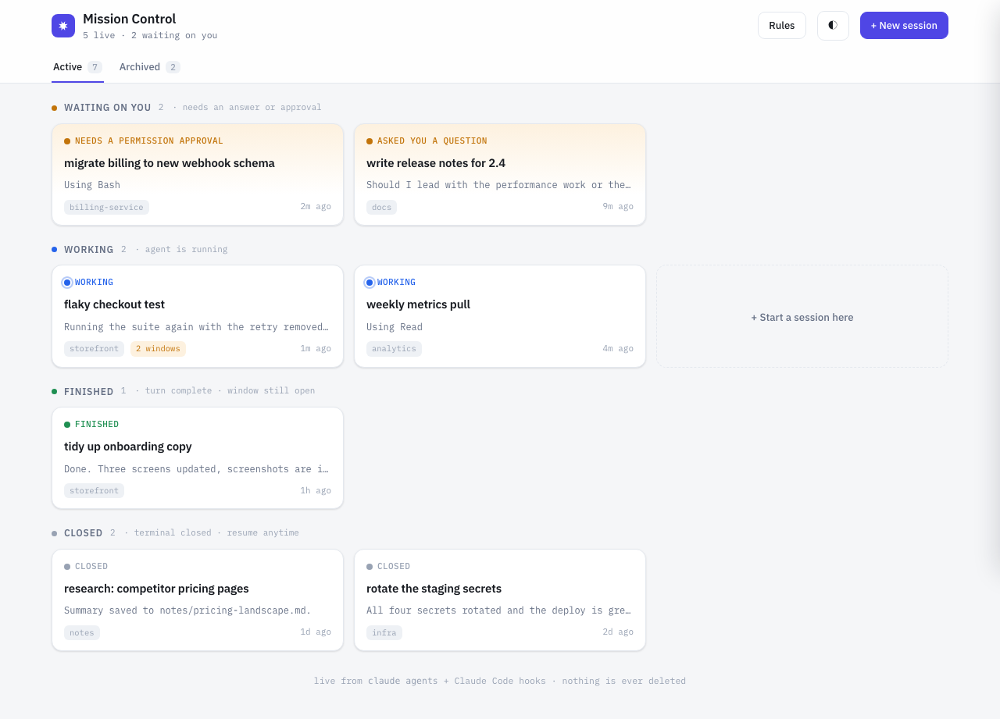

# Mission Control

A local board for all your Claude Code sessions. One page that shows who needs you, who is working, who is finished, and lets you jump straight to the right terminal window.



If you run more than a couple of Claude Code sessions at once, the terminal stops working as an interface. You cannot tell which window is waiting for an answer, which one is still running, and which one finished ten minutes ago. Mission Control reads what Claude Code already knows and puts it on one screen.

Everything stays on your machine. No login, no cloud, no dependencies, no build step. Nothing is ever deleted.

**Where to go:** http://localhost:3011

## Demo

To try the UI without any sessions of your own: `npm run demo` serves fixture data on the same port.

## Requirements

- macOS (window focus and launching terminals use AppleScript; the board itself runs anywhere)
- Node 22 or newer
- Claude Code 2.1 or newer (`claude agents --json` is what the board polls)

## Install

```bash
git clone https://github.com/samivis/mission-control.git
cd mission-control
npm start                 # http://localhost:3011
npm run install-hooks     # one time, see below
```

`npm run open` opens the board in a standalone window (Chrome, Brave, Arc or Edge if you have one, otherwise your default browser).

### Hooks (one time)

```bash
npm run install-hooks
```

This backs up `~/.claude/settings.json` to `~/.claude/settings.json.bak-<timestamp>` and adds one small async hook for each of `SessionStart`, `SessionEnd`, `UserPromptSubmit`, `Stop`, `Notification` and `PermissionRequest`. The hook script appends one JSON line to `~/.mission-control/events.jsonl` and exits in a few milliseconds. It never blocks or fails a session. Hooks you already had are kept.

Hooks apply to sessions started after they are installed. Sessions already open fall back to reading their transcript until you restart them.

`npm run uninstall-hooks` removes only the Mission Control entries, with a backup first.

## How it works

- **Live sessions and busy or idle** come from `claude agents --json`. It lists every running Claude Code process, including ones you started by hand in a terminal, with its pid, folder and session id. Several pids on one session id means several terminal windows are attached to it, and the card shows an "N windows" chip.
- **Waiting on you** comes from the hooks. A permission prompt or a turn that ended on a question sends the session to the Waiting lane. Without hooks, the board reads the transcript tail instead.
- **Names, last message and the full transcript** are read straight from `~/.claude/projects/**/*.jsonl`. Mission Control never writes there.
- **Custom names, archive flags and lane overrides** live in `~/.mission-control/meta.json`.

## Lanes

| Lane | Meaning |
|---|---|
| **Waiting on you** | Needs an answer or a permission approval. Always sorted first. |
| **Working** | The agent is running right now. |
| **Finished** | Turn complete, window still open. The agent reported and stopped, and nothing was asked of you. |
| **Closed** | Terminal closed, resume anytime. The transcript is on disk and Resume continues the conversation. |
| **Archived** | Off the Active tab, by hand or automatically after 7 idle days. Reopen anytime. |

Finished and Closed are both idle. The only difference is whether the terminal window is still there.

## Card actions

- **Click a card** to read the full transcript in a side drawer.
- **Focus window** finds the terminal tab that owns the session (pid, then tty, then Terminal.app or iTerm2) and brings it to the front. It never opens a second window for a live session.
- **Resume** appears on Closed cards and opens one new Terminal window with `claude --resume <id>` in the session's folder.
- **Rename**, **Archive** and **Reopen** do what they say.
- **New session** takes a folder, a name and a first prompt, and opens a Terminal window running `claude` there.

## Drag a card to fix the board

Drag any card onto another lane, or onto the Archived tab, or use the Move menu on the card. The card gets pinned there with a "moved by you" chip, and the pin lasts until that session takes its next turn. Working and Closed are facts, so pins into those lanes are display-only: a dead process never shows as Working and a live one never shows as Closed.

### The board learns from your moves

The Waiting versus Finished call is the one judgment the board makes on its own, by reading the last message. Every time you move a card between those two lanes, the move is logged to `~/.mission-control/corrections.jsonl` with the message that was judged.

After every three corrections, or when you press "Learn now" in the Rules popover, or with `npm run learn`, a headless Claude call reads the current phrase lists plus the new corrections and proposes updated lists, with a one-line reason for each change:

```bash
printf '%s' "$PROMPT" | claude -p --output-format json --no-session-persistence --tools ""
```

The reply is validated before anything is written. Every write backs up `~/.mission-control/rules.json` first, and "Revert last learning" restores it. Changes and reasons land in `~/.mission-control/learning-log.jsonl` and show in the Rules popover.

The rules are a few fixed base rules (a message that ends with a question mark, or has one in its last paragraph, is waiting) plus two editable phrase lists matched against the last paragraph: `askPhrases` push a session to Waiting, `reportPhrases` keep it in Finished. You can edit both by hand in the popover.

## Keep it always running

```bash
npm run install-service
```

This installs two macOS launch agents:

- `ai.mission-control.server` starts the server at login and restarts it if it ever dies.
- `ai.mission-control.window` waits for the server at login, then opens the board once in a standalone window.

Both use the `node` on your PATH at install time, so it works with nvm and similar. If the repo lives in `~/Desktop` or `~/Documents`, macOS may ask once to allow access for `node`, since launch agents are not given those folders by default. Logs go to `~/.mission-control/server.log`. The server idles at a few megabytes of memory and polls `claude agents --json` every three seconds, which you will not notice.

```bash
npm run uninstall-service    # stop both agents and remove them
```

## Configuration

`~/.mission-control/config.json` is created on first start:

| key | default | meaning |
|---|---|---|
| `port` | 3011 | the port the board listens on (`PORT=` overrides it) |
| `skipPermissions` | false | when true, Resume and New session launch `claude --dangerously-skip-permissions`. Turn it on only if that is already how you run your sessions |
| `autoArchiveDays` | 7 | idle or closed sessions leave the Active tab after this many days. Never live sessions. Nothing is deleted |
| `pollMs` | 3000 | how often `claude agents --json` is polled |

## Uninstall

```bash
npm run uninstall-service
npm run uninstall-hooks
rm -rf ~/.mission-control      # names, archive flags, rules, event log
```

Your Claude Code transcripts in `~/.claude` are untouched throughout.

## Tests

```bash
npm test
```

## About

Built in an afternoon with Claude Code, after a bigger attempt that forked a full web UI turned out to be the wrong shape for the problem. The whole thing is a few hundred lines of plain Node and one HTML file.

Not built yet: replying from the drawer, and a Slack away mode that pings you when a session is waiting and lets you answer from Slack.

MIT, Samidha Visai.
